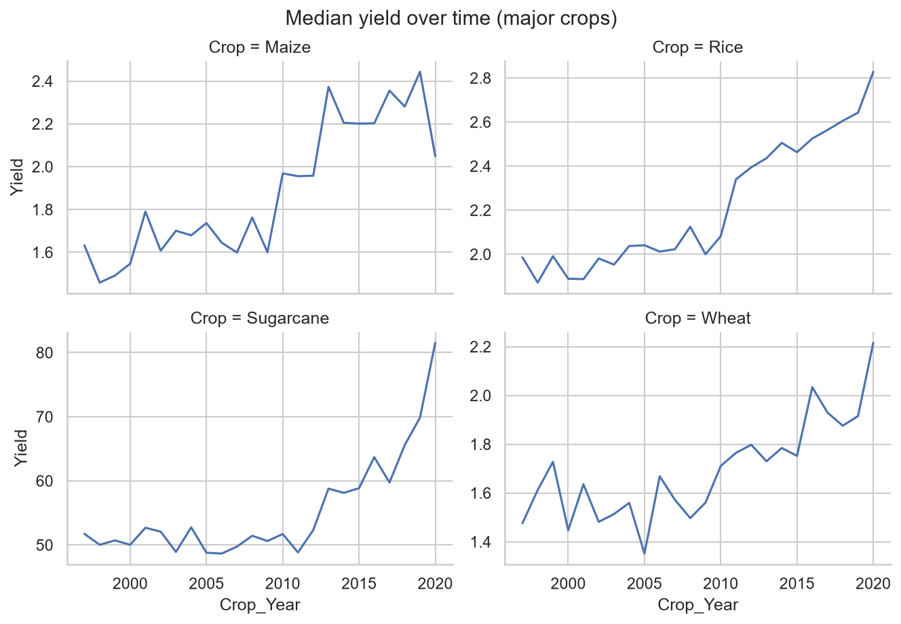
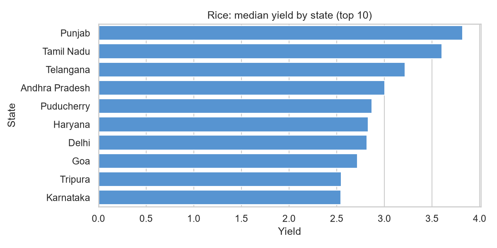
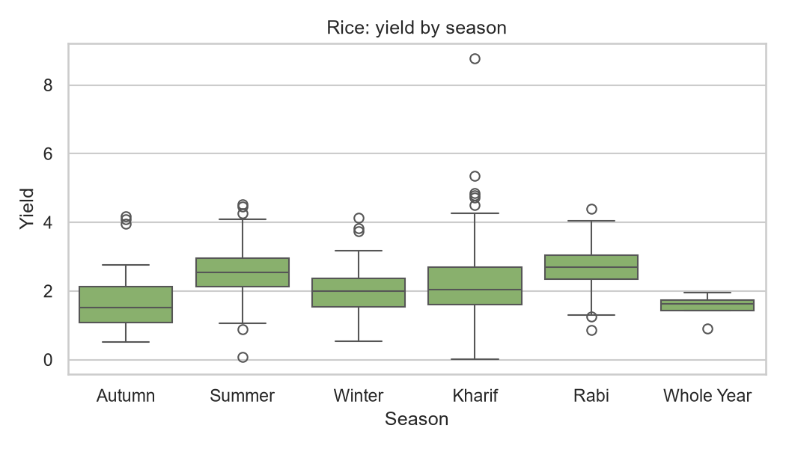
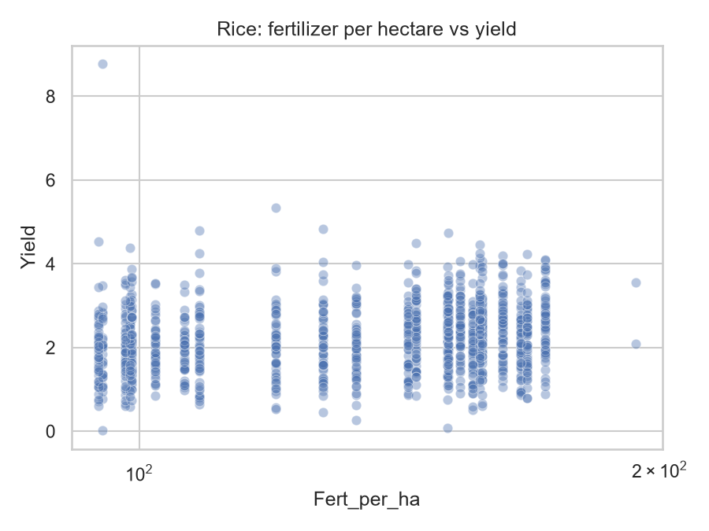
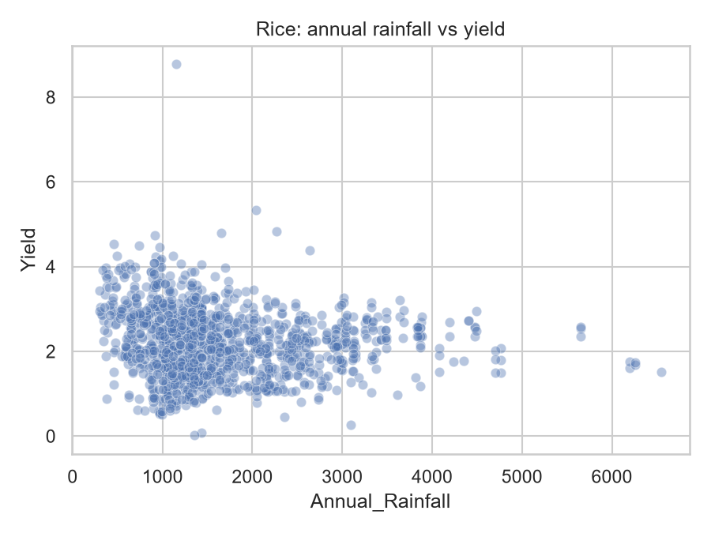
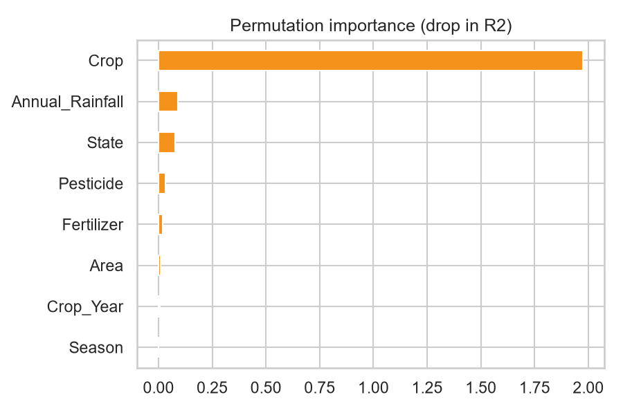

# Crop Yield Prediction and Analysis 

Predicting crop yield for Indian agriculture (1997–2020) with a **leak-free scikit-learn pipeline**, 5-fold cross-validation, per-crop error analysis, and data-driven insights on what separates high- and low-yield crops, states and seasons.

## Overview
- **Task:** regression, predict `Yield` from crop, season, state, year, area, rainfall, fertilizer and pesticide
- **Final model:** Random Forest, CV R² = **0.972**, MAE = **8.99** (mean baseline: R² = 0.00, MAE = 150.3)
- **Stack:** Python, pandas, scikit-learn, XGBoost, matplotlib, seaborn

## Dataset
[Omdena Crop Yield Prediction dataset](https://datasets.omdena.com/dataset/crop-yield-prediction): 19,689 rows, 55 crops, 30 states, 1997–2020. No missing values or duplicates.

| Column | Meaning |
|---|---|
| Crop, Season, State | categorical features |
| Crop_Year, Area, Annual_Rainfall, Fertilizer, Pesticide | numeric features |
| Production | **dropped**: Yield ≈ Production ÷ Area (see "Fixing v1") |
| Yield | target |

## Approach
1. Cleaned the data (stripped trailing spaces in `Season`, `State`, `Crop`).
2. Removed `Production`, which leaks the target.
3. Built one `Pipeline` per model: one-hot encoding for categoricals and standard scaling for numerics, fitted on training folds only.
4. Compared Baseline (mean), Linear Regression, Random Forest and XGBoost with 5-fold CV.
5. Analysed errors per crop and key drivers (permutation importance, grouped statistics).

## Results (5-fold CV)
| Model | R² (mean) | R² (std) | MAE |
|---|---|---|---|
| Baseline (mean) | -0.000 | 0.000 | 150.26 |
| Linear Regression | 0.842 | 0.020 | 60.50 |
| **Random Forest** | **0.972** | 0.019 | **8.99** |
| XGBoost | 0.966 | 0.022 | 10.46 |

Hold-out set (Random Forest): R² = 0.980, MAE = 9.41, **median absolute error = 0.13**.

**Per-crop error** (MAE as % of the crop's median yield):
- Best: Sugarcane (10.4%), Garlic (10.7%), Coconut (11.0%), Soyabean (11.8%), Tapioca (11.8%)
- Worst: Cashewnut (869%), Cardamom (279%), Other Summer Pulses (146%), Tobacco (117%), Sannhamp (82%)

> R² is dominated by a few very large values (coconut yields are in the thousands, most crops are around 1), so I also report median error and per-crop error. Full tables are in `results/`.

## Key insights
*Yield units differ across crops, so comparisons are made within a single crop.*

1. **Yields rose over time.** Comparing the first and last three years of data, median yield rose ~35% for rice, ~21% for wheat, ~54% for maize and ~31% for sugarcane.
   
2. **Large gaps between states.** Punjab (3.82), Tamil Nadu (3.60) and Telangana (3.22) lead in median rice yield; Jharkhand is far lower at 1.00.
   
3. **Season matters for rice.** Median rice yield is highest in Rabi (2.70) and Summer (2.54), and lowest in Autumn (1.51).
   
4. **Inputs show weak relationships.** For rice, fertilizer per hectare is weakly positively associated with yield (Spearman 0.23) and annual rainfall weakly negatively (-0.16). These are associations, not causal effects, and the fertilizer and pesticide columns look like coarse totals.
    
5. **The model mostly learns "which crop".** Permutation importance is dominated by `Crop`, followed by rainfall and state. Crop is large partly because yield units differ across crops, so this shouldn't be read as an agronomic finding.
   

## Fixing v1: What I changed from my first version
The original notebook had several issues that inflated or distorted results:
- **Target leakage:** `Production` was used as an input, and Yield ≈ Production ÷ Area. Removing it is essential for an honest model.
- **`Crop` was missing from the yield model**, although yield differs enormously by crop. Adding it back was the main accuracy recovery.
- **Scaling was computed but never used**, so SVC, SVR and Logistic Regression were compared on unscaled data. Scaling now lives inside the pipeline.
- **`LabelEncoder` on input features** imposed a fake order on categories; replaced with one-hot encoding.
- **Weak evaluation:** a single split with only accuracy/MSE. Replaced with baselines, 5-fold CV, R², MAE, median error and per-crop error.
- **Not reproducible:** relied on Google Drive paths. Now runs locally from a relative `data/` path.

Re-running the original setup (with `Production`, without `Crop`) gave R² ≈ 0.955; removing `Production` alone dropped it to ≈ 0.74. That shows how much of the original score came from leakage. Adding `Crop` back gives an honest ≈ 0.97.

**Scope change:** the v1 crop-type classifier was removed from the main pipeline. It depended on `Production`, and without it Random Forest accuracy fell from ~70% to ~48% across 55 classes. Predicting crop type from input quantities is not a well-posed problem on this data.

## Limitations
- Cross-validation splits rows randomly, so the same years appear in train and test. The model estimates yield for known crops, states and years. It is not a forecast for future years.
- Rare, low-yield crops (e.g. Cashewnut, Cardamom) have high relative error.
- Fertilizer, pesticide and rainfall appear to be coarse, aggregated values, so I make no agronomic claims from them.
- No hyperparameter tuning beyond sensible defaults.

## Project structure
```
├── data/crop_yield.csv
├── notebooks/              # original v1 notebook (kept for reference)
├── src/
│   ├── train.py            # trains the final model
│   ├── evaluate.py         # baseline + CV + per-crop error
│   └── insights.py         # charts and summary statistics
├── results/                # metrics tables and charts
├── requirements.txt
└── README.md
```

## How to run
```bash
pip install -r requirements.txt
python src/evaluate.py     # CV results + per-crop error -> results/
python src/insights.py     # charts + printed statistics -> results/
python src/train.py        # trains and saves the model
```

## Future work
- Serve the model with FastAPI, containerise with Docker and deploy
- Time-based validation (train on past years, test on later years)
- Per-crop models or log-scale targets for rare crops

## Author
**Bagusetty Gayatri**, M.Tech Data Science | https://www.linkedin.com/in/bagusetty-gayatri/ | bagusettygayatri@gmail.com
